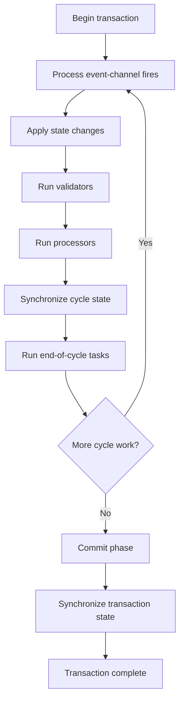

# TFW Transaction and State Management (TSM)

## 1. Introduction

TFW's Transaction and State Management (TSM) framework provides a way to build applications from components that communicate through event channels. Rather than having components call one another directly, TSM manages the propagation of state changes and determines which components need to execute as a result.

The design is based on the component-oriented approach described in *Component Software: Beyond Object-Oriented Programming*. Components declare their inputs and outputs, while the framework manages the state supplied to them and coordinates their execution.

In this model, components are intended to be stateless: the framework supplies the current input state immediately before a component executes. A component performs its work using that state and publishes any resulting state changes through its declared outputs. The framework then determines what additional work those changes require.

This separation has several benefits:

- Components can be developed independently, with dependencies expressed through event channels.
- The framework can determine which components are affected by a state change.
- Components can be delayed until the state they require is available.
- A transaction can continue through multiple processing cycles until all consequential state changes have been handled.
- Validation, rollback, and commit processing provide a way to coordinate application behavior around a transaction.

This document introduces the central TSM concepts and illustrates them with the `HelloWorld` and `AdditionDemo` examples. It is intended as a conceptual introduction; additional examples and more detailed explanations of individual features can be added over time.

## 2. Components and event channels

### 2.1 Components

A TSM application is assembled from components. Each component has a defined responsibility and declares the event channels it reads and, where appropriate, the event channels it may change.

The framework uses these declarations to determine component dependencies and to coordinate execution. Components do not need to know which other components publish the state they consume or which components will consume the state they produce.

This encourages components to have focused responsibilities and makes it possible to change the application by adding, removing, or rearranging components without requiring direct calls between them.

Components are intended to be stateless in the sense that application state is supplied by the framework when they execute. A component should not depend on retained internal state from a previous execution to determine its behavior. Instead, its declared inputs provide the state needed for the current execution.

### 2.2 Event channels

Event channels are the primary means by which components communicate. A channel represents a piece of state or, in the case of a stateless trigger, an event that causes processing.

A component that publishes state does not need to know which components subscribe to it. Likewise, a component that consumes state does not need to know which component produced it. The framework connects these relationships and coordinates the consequences of changes.

Event channels can carry state values or act as stateless triggers. A state-bearing channel represents a value that components may read; a stateless trigger communicates that something should happen without carrying a state value.

A useful design principle is to use a separate event channel for each logically independent piece of state rather than placing several unrelated values in one container. This allows a component to depend only on the values it actually needs. If unrelated values share a channel, changing one field can cause processing in components that care about other fields but do not care about the change that occurred.

### 2.3 Choosing state values

Prefer immutable values for state carried by event channels. Immutability makes it easier to reason about what a component sees when the framework supplies state and helps prevent changes from occurring outside the framework's state-management process.

Primitive wrapper types such as `Integer` and `Long` are immutable and are suitable for many simple state values.

Collections require more care. An unmodifiable collection prevents callers from changing the collection through that interface, but it does not necessarily make the entire object graph immutable. The collection may still refer to mutable objects, and other references may permit changes to its contents.

Arrays are also mutable. Declaring an array reference `final` prevents the reference from being reassigned, but does not prevent its elements from changing. TFW's `tfw.immutable` package provides immutable array abstractions, including ILAs, for cases where an array-like value is useful but mutable array state is undesirable.

The general goal is to make the state observed by a component stable and predictable for the duration of its processing.

### 2.4 State change rules

A state change rule is an important part of defining an event channel. It determines whether a transition from one state value to another is considered a meaningful state change.

This decision affects processing. TSM uses recognized state changes to determine which consequential work needs to be performed. A rule should therefore reflect the semantics of the value carried by the channel: two values that are equivalent for the application's purposes should not necessarily trigger additional processing merely because they are represented by different objects.

The choice of rule is part of the channel's design, not just an implementation detail. The appropriate rule depends on what a change in that particular piece of state means to the application.

Specific rules and their effects are best illustrated with examples, so this introductory guide does not attempt to catalog all the available rule types.

### 2.5 Grouping event channels and components

Enumerations can be used to group and document event channels and components. This provides a logical organization for the definitions and makes related parts of an application easier to understand.

An enumeration can also provide a convenient way to supply a group of event channels or components to a `Root` or `Branch` when assembling an application. This can reduce the amount of repetitive assembly code and make the intended structure clearer.

The details are easier to understand in context, so examples of enumeration-based organization can be added in a later revision.

## 3. Transactions and processing cycles

### 3.1 The transaction model

TSM processes related work within a transaction. A transaction begins with initiating work, such as an initial state change or a trigger, and continues while the framework has consequential work to perform.

A single transaction may require several processing cycles. For example, one component may publish a new value, causing another component to execute. That component may publish a further value, which in turn causes additional components to execute. TSM continues processing until the resulting work has been handled.

The transaction therefore represents more than one call to a component. It provides a boundary within which the framework coordinates the propagation of state changes and the processing those changes require.

### 3.2 Processing cycles

A processing cycle handles pending work in a defined order. At a high level, the cycle proceeds through the following stages:

1. Process event-channel fires.
2. Apply pending state changes.
3. Execute validators.
4. Execute processors.
5. Synchronize cycle state.
6. Execute end-of-cycle tasks.
7. Repeat if more consequential work remains.

The transaction manager's cycle processing follows this order:

- `executeEventChannelFires()`
- `executeStateChanges()`
- `executeValidators()`
- `executeProcessors()`
- `synchronizeCycleState()`
- `executeEndOfCycleRunnables()`

The framework repeats the cycle while there are pending state changes, event-channel fires, or processors that need to execute.

This ordering matters. For example, validators run before processors in the cycle. State changes produced during processing may create work for a subsequent cycle rather than being treated as though every component must execute immediately in a single pass.

The cycle model allows the framework to manage dependencies and propagate changes until the application reaches a stable point for that transaction.

### 3.3 State changes and component execution

Components declare their inputs and outputs so that TSM can determine which components may be affected by state changes.

An output declaration identifies a channel that a component may change. It does not mean that the component must change that channel every time it executes.

When a recognized state change occurs, the framework uses the declared dependencies to determine what work becomes necessary. Components whose required inputs are not yet available can be delayed until the relevant state becomes available.

This is one of the key distinctions between TSM and an approach in which application code manually calls a sequence of methods: the framework manages the dependencies and the resulting execution order.

### 3.4 An overview of transaction processing

The following diagram summarizes the processing cycle and the transition to transaction completion.

This is a conceptual overview of the processing stages. The transaction manager is responsible for the actual coordination of pending work and the completion of the transaction.

## 4. Reactive and non-reactive inputs

TSM distinguishes between reactive and non-reactive inputs.

A reactive input can cause a component to execute when its state changes. A non-reactive input does not, by itself, trigger execution when its state changes. Instead, the component reads the non-reactive input when it executes for another reason.

This distinction is useful when deciding which state changes should cause work and which values should simply be available to a component when it runs.

For example, a component may need a configuration value as well as a changing input value. If the configuration value is non-reactive, changing it alone does not trigger the component. When the component executes because of a reactive input or another trigger, it uses the current configuration value.

**Non-reactive does not mean optional.** When a component executes, all required state-bearing inputs must be non-null, whether those inputs are reactive or non-reactive. Stateless trigger channels are different because they do not carry a state value.

The distinction is about what causes execution, not whether the input's state is required.

## 5. State availability and diagnostic processing

A component can execute its normal processing only when the state it requires is available.

State-bearing event channels may initially contain `null`, but required inputs must be non-null for normal processing. TFW checks the availability of required inputs and provides diagnostic processing paths for components that cannot perform their normal work because state is missing.

These diagnostic paths help distinguish between an application that is behaving as designed while waiting for state and one that has reached a condition that requires investigation.

The details vary by component type:

- **Converters** use `convert()` when their required inputs are available. Otherwise, they use `debugConvert()`.
- **Triggered converters** use `convert()` when the trigger fires and the required state inputs are available. Otherwise, they use `debugConvert()`.
- **Synchronizers** provide `debugConvertAToB()` and `debugConvertBToA()` for the corresponding conversion directions when required state is unavailable.
- **Validators** use `validateState()` when their required inputs are available. Otherwise, they use `debugValidateState()`.
- **Commit components** use `debugCommit()`, inherited from `BaseCommit`, when a component would otherwise execute but required state is missing.

Initiators do not have input-bearing processors, so they do not use these input-state diagnostic methods.

These methods provide an opportunity to report or investigate missing state without treating an incomplete input set as though normal processing had succeeded. Their implementation should help developers understand which required values are unavailable and why normal work could not proceed.

## 6. Example 1: HelloWorld

`HelloWorld` is a small example that demonstrates the basic structure of a TSM application.

It illustrates how an application can use an initiator to introduce work, a stateless trigger to signal that an action should occur, and a triggered commit component to perform the resulting action.

The principal concepts are:

- An `Initiator` can introduce the initial state changes needed to begin processing.
- A `StatelessTriggerECD` represents a trigger that does not carry a state value.
- A `TriggeredCommit` responds to the trigger and performs its commit operation.

The example provides a simple starting point for understanding how the framework coordinates components without requiring those components to call one another directly.

For the exact setup and implementation, see the `HelloWorld` example in the TFW source tree.

## 7. Example 2: AdditionDemo

`AdditionDemo` demonstrates a more involved interaction between state-bearing channels, processors, validation and rollback.

The example provides an interface for entering values and calculating a sum. It also illustrates how conversion errors can be handled as part of transaction processing rather than simply allowing invalid state to propagate through the application.

Its components include:

- A `StatelessTriggerECD` used by the Calculate button to request a calculation.
- Event channels carrying the relevant text, integer and result state.
- An `IntegerSynchronizer` that converts between text and integer representations.
- An `AdditionConverter` that calculates the sum.
- A `StringRollbackECD` named `errorText` for carrying error information associated with rollback.
- An `ErrorMessageCommit` that reports the error through commit processing.

Some of the example's object event channels begin with `null`. This allows the application to represent state that has not yet been supplied. Normal processing still depends on the required state-bearing inputs being non-null.

The `IntegerSynchronizer` illustrates how conversion can fail. If text cannot be parsed as an integer, the synchronizer can request rollback and supply error state for a follow-on transaction. This allows the application to return to a suitable state and communicate the problem without treating the failed conversion as a successful update.

The `AdditionConverter` performs the addition when the required inputs are available. The Calculate trigger provides an explicit way to request the operation, rather than requiring every change to every input to initiate a calculation.

The example brings together several TSM concepts: independent components, event-channel state, triggered processing, input availability, error handling and transaction control.

## 8. Rollback

Rollback allows a component to request that the current transaction be rolled back when processing cannot be completed successfully.

A validator may request rollback when it determines that the current state is invalid. Rollback is not limited to validators, however: converters and synchronizers can also request rollback when they encounter a condition that makes the current transaction unsuitable for completion.

For example, a synchronizer may fail to convert a text value to an integer. Continuing with the invalid result could cause other components to process inconsistent state. Requesting rollback provides a way to prevent the failed operation from being treated as a successful transaction.

Rollback can also be associated with follow-on state. TSM provides a mechanism such as `rollback(RollbackECD, Object)` to supply state for a separate follow-on transaction. An application can use this to communicate an error or establish state needed to recover after the failed transaction.

Rollback should be understood as part of transaction management, not simply as an exception-handling substitute. It allows components to signal that the intended transaction should not proceed as a successful update.

The transaction helper handles a `RollbackException` by invoking rollback processing. The overall transaction-completion path also performs commit-related cleanup and transaction-state synchronization. Therefore, rollback should not be described as skipping every subsequent commit-related operation. Applications should use commit components for their intended purpose and should not assume that rollback eliminates all transaction-completion behavior.

## 9. Commit processing

Commit components provide a place to perform actions at the end of transaction processing, after the state changes and the resulting processing cycles have been handled.

They are useful when the application needs to communicate with code or systems outside the TSM state-processing model. Examples include notifying non-TFW code or performing a side effect that should happen only after the transaction's processing has completed.

A key design rule is that commit processing should not change state in the current transaction. Commit components are intended for actions that follow the processing of state, not to introduce new state changes into a transaction that has already reached its commit phase.

If an action needs to produce further TSM state changes, it should be designed so that those changes occur through an appropriate transaction rather than by modifying the state of the transaction being committed.

`Commit` and `TriggeredCommit` serve related but different purposes. A commit component participates in commit processing according to its declared dependencies, while a triggered commit is associated with a trigger. `HelloWorld` demonstrates the triggered form, and `AdditionDemo` demonstrates commit processing in the context of error reporting.

## 10. Composition and application structure

### 10.1 Roots and branches

TSM applications can be assembled hierarchically using `Root` and `Branch`.

A `Root` is the top of the event-channel communication tree. It extends `Branch` and owns the `TransactionMgr` that coordinates transaction processing. Event channels that reach the root must be properly terminated or the framework reports an error.

A `Branch` groups components and other branches into a logical unit. This allows an application to be assembled from smaller pieces and makes it easier to organize related functionality.

Branches are not merely static containers. The framework supports adding and removing components and branches, including operations that combine additions and removals. It also manages the connections and transaction-manager participation of the resulting tree.

This hierarchical structure allows a larger application to be composed from reusable groups of components rather than assembled as one flat collection.

### 10.2 Event-channel translation and termination

Branches also define how event channels connect across the hierarchy.

A branch can translate a child event channel to a corresponding parent event channel. Translation allows a channel in a nested component group to be connected to a channel at the containing level.

A branch can also terminate an event channel. A terminator identifies the point in the hierarchy where that channel stops propagating. Events published within the tree travel upward until they reach the terminator; when a state change is recognized, the resulting state is reflected back down the tree to the relevant subscribers.

Translation and termination are distinct ways of defining the communication structure. A channel cannot be both terminated and translated in the same way. The channel definitions and connection rules determine where a channel is available and how state moves through the tree; it should not be assumed that every channel is automatically visible everywhere.

### 10.3 Multiplexed branches

`MultiplexedBranch` is a specialized branch component for cases where multiple child components need to communicate through a shared parent event channel.

It multiplexes child event channels into a single parent event channel and demultiplexes the parent channel back into child-specific state. Each child is associated with a slot identifier. Components assigned to the same slot are grouped into an ordinary sub-branch for that slot.

The multiplexed branch manages these sub-branches as slots are added or removed. When a slot no longer contains components, its sub-branch can be removed.

A `MultiplexedBranchFactory` configures the mapping between the child and parent channels, the state change rule and the multiplexing strategy. The strategy defines how the aggregate parent state is converted to and from per-slot child state. TFW provides a standard strategy for object ILAs, and custom strategies can be used when the application needs a different representation.

Multiplexed branches are a more specialized composition feature. They are useful when the application needs a collection of similar component groups to share a common channel interface without requiring a separately named parent channel for every child.

## 11. Designing TSM applications

The following principles provide a useful starting point when designing an application with TSM.

### Keep component responsibilities focused

Each component should have a clear responsibility and declare the inputs and outputs relevant to that responsibility. This helps the framework determine dependencies and makes individual components easier to understand and reuse.

### Model independent state independently

Use separate event channels for logically independent pieces of state. Avoid grouping unrelated values in one state object if doing so causes components to depend on changes they do not actually care about.

### Prefer immutable state values

Use immutable values wherever practical. Be particularly careful with arrays and collections, where an apparently fixed reference or an unmodifiable view does not necessarily make the underlying data immutable.

### Choose state change rules deliberately

A state change rule determines when a transition is meaningful to the application. Choose a rule that reflects the semantics of the channel's state rather than assuming that every difference in representation must trigger processing.

### Distinguish triggering from required state

Use reactive inputs for state changes that should trigger component execution and non-reactive inputs for values that should be read when the component runs for another reason. Remember that required non-reactive inputs must still be available when normal processing takes place.

### Declare potential outputs accurately

A component should declare the event channels it may change. The framework uses these declarations to coordinate processing, even though a particular execution may not change every declared output.

Take particular care with components such as converters and synchronizers that use a channel as both an input and an output. A change to an output can cause further processing, potentially including another execution of the same component. The resulting processing must converge rather than continually generating new changes.

### Use diagnostics to understand missing state

When a component cannot perform its normal work because a required input is missing, implement the relevant diagnostic method to make the condition understandable. This is especially useful when the initial state of an application is incomplete by design.

### Use rollback for failed transactions

If a component determines that the current transaction should not be completed successfully, request rollback through the appropriate TSM mechanism. Consider whether a follow-on transaction should establish recovery state or communicate an error.

### Keep commit processing separate from state processing

Use commit components for actions that should occur after the transaction's state processing is complete. Do not use commit processing to change the state of the transaction being committed.

### Compose larger applications from branches

Use branches to organize related components and build larger applications hierarchically. Where appropriate, use enumerations to document and group event channels or components, and use multiplexed branches when multiple component groups need to share a common parent channel interface.

## 12. Glossary

**Branch** — A hierarchical component that groups components and branches and manages their connections within the TSM tree.

**Commit component** — A component that performs an action during commit processing, after the transaction's state-processing work has completed.

**Component** — A unit of application functionality that declares its input and output event channels and performs its work using state supplied by the framework.

**Event channel** — A communication mechanism that carries state or represents a stateless trigger between components.

**Initiator** — A component that introduces the initial work or state changes needed to begin processing.

**Multiplexed branch** — A specialized branch that maps multiple child channels through a shared parent channel, using slot-specific sub-branches and a multiplexing strategy.

**Non-reactive input** — An input whose state change does not, by itself, trigger component execution, but whose state must be available when normal processing requires it.

**Reactive input** — An input whose state change can trigger component execution.

**Root** — The top of the TSM communication tree, which owns the transaction manager.

**Rollback** — A mechanism for requesting that the current transaction not complete as a successful state update.

**State change rule** — A rule that determines whether a transition between state values is considered a meaningful state change.

**Transaction** — A unit of TSM processing that can include multiple cycles of state changes and component execution, followed by transaction completion.

**Transaction manager** — The part of TSM that coordinates processing cycles, transaction completion, and related state synchronization.

**Validator** — A component that evaluates state and can request rollback when the state is invalid.

## 13. Source code and further reading

The most useful next step is to read the examples alongside this introduction:

- `HelloWorld` — a minimal example of initiators, stateless triggers and triggered commit processing.
- `AdditionDemo` — an example of state-bearing event channels, conversion, calculation, error handling and rollback.

The TFW repository also contains the implementation and documentation for the relevant TSM classes, including `Root`, `Branch`, `MultiplexedBranch`, the processor types and the event-channel definitions.

For additional background, see the project's `README.md`, `CONTRIBUTING.md`, current Javadocs and the historical `tutorial/TFW-Introduction.ppt`. The tutorial is historical material and should be read with that limitation in mind.

This document is an initial conceptual guide. More detailed examples can be added later to explain individual state change rules, enumeration-based organization, hierarchical composition and other TSM features in context.